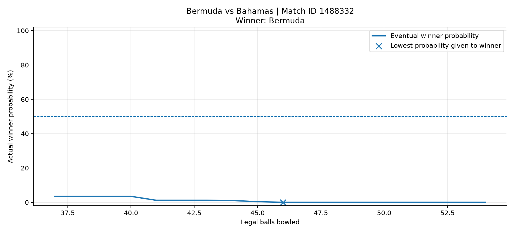
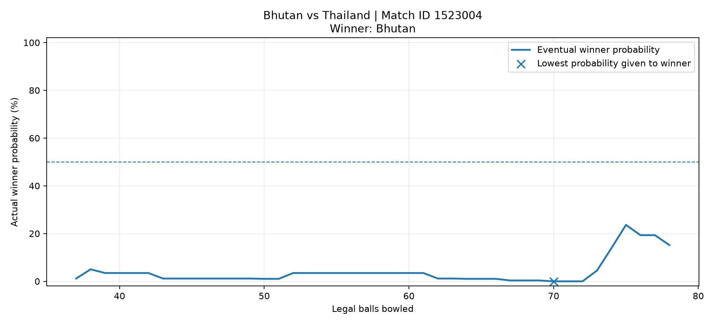
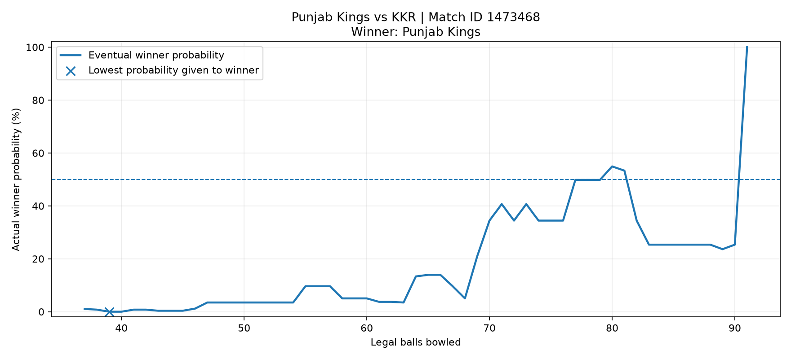
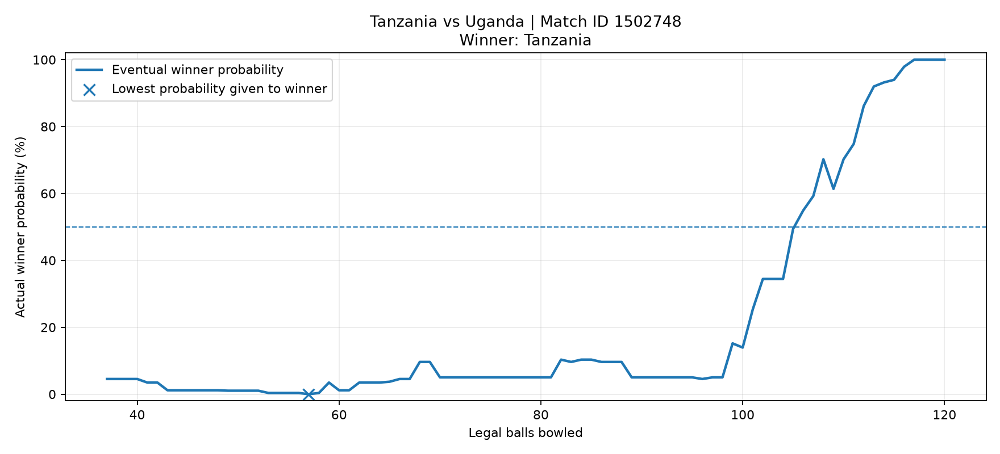
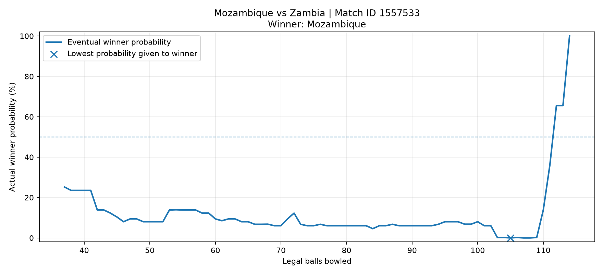

# Day 24 — Model Failure Gallery

## Scope and methodology

Five matches were selected from the held-out chase test set. For each match, the analysis reproduces the calibrated production prediction using the saved XGBoost model and isotonic calibration mapping.

The principal diagnostic is the lowest probability assigned to the eventual winner after the powerplay.

- `p_chase` is the predicted probability that the chasing team wins.
- `p_winner` is the probability assigned to the actual match winner.
- For a chase loss, `p_winner = 1 - p_chase`.
- For a chase win, `p_winner = p_chase`.

All five selected matches passed the basic data checks: consistent labels and team identities, and no duplicate legal-ball state numbers.

## Selected failures

### F-01 — Bermuda vs Bahamas

- Match ID: `1488332`
- Date: 19 June 2025
- Actual winner: Bermuda
- Target: 115
- Worst state: 79/2 after 46 legal balls
- Runs required: 36
- Stored balls remaining: 74
- Probability assigned to actual winner: 0%

**Diagnosis:** The match used a nine-over innings limit, but the feature pipeline calculated balls remaining using a 120-ball assumption. At ball 46, the actual innings had only eight legal balls remaining, not 74.

**Classification:** Critical feature-pipeline defect. This case is not a clean test of model quality.

### F-02 — Bhutan vs Thailand

- Match ID: `1523004`
- Date: 28 February 2026
- Actual winner: Bhutan
- Target: 87
- Worst state: Thailand 68/4 after 70 legal balls
- Runs required: 19
- Stored balls remaining: 50
- Probability assigned to actual winner: 0%

**Diagnosis:** The match used a 13-over innings limit. At ball 70, the actual innings had eight legal balls remaining, not 50. The stored state therefore materially misrepresented the chase.

**Classification:** Critical feature-pipeline defect. This case is not a clean test of model quality.

### F-03 — Punjab Kings vs Kolkata Knight Riders

- Match ID: `1473468`
- Date: 15 April 2025
- Actual winner: Punjab Kings
- Target: 112
- Worst state: KKR 57/2 after 39 legal balls
- Runs required: 55
- Balls remaining: 81
- Wickets in hand: 8
- Probability assigned to actual winner: 0%

**Diagnosis:** This is a severe overconfidence failure in a standard 20-over chase. The model assigned the chasing team a 100% win probability despite the eventual winner still having a substantial defence ahead. KKR were eventually dismissed for 95.

The precise cricketing or feature-level explanation has not yet been established.

**Classification:** Genuine model failure requiring further investigation.

### F-04 — Tanzania vs Uganda

- Match ID: `1502748`
- Date: 28 September 2025
- Actual winner: Tanzania
- Target: 129
- Worst state: Uganda 80/1 after 57 legal balls
- Runs required: 49
- Balls remaining: 63
- Wickets in hand: 9
- Probability assigned to actual winner: 0%

**Diagnosis:** The model was extremely confident in Uganda's chase, but Uganda eventually finished on 119/9 and lost. The exact cause of the collapse and the model's overconfidence has not yet been isolated.

**Classification:** Genuine model failure requiring further investigation.

### F-05 — Mozambique vs Zambia

- Match ID: `1557533`
- Date: 25 October 2026
- Actual winner: Mozambique
- Target: 110
- Worst state: Mozambique 82/7 after 105 legal balls
- Runs required: 28
- Balls remaining: 15
- Wickets in hand: 3
- Probability assigned to actual winner: 0%

**Diagnosis:** The model underestimated the eventual winner during a difficult late chase. Mozambique scored the remaining runs and won at ball 114.

The model's late probability increased as the chase progressed, but it substantially underestimated the eventual winning outcome at the selected worst state.

**Classification:** Genuine model failure requiring further investigation.

## Cross-case findings

1. Two of the five cases are affected by the same shortened-innings feature-engineering defect.
2. Three cases remain genuine model failures on standard 20-over innings limits.
3. The saved isotonic mapping contains plateaus at 0 and 1. This permits exact 0% and 100% predictions in nonterminal states.
4. A probability of exactly 0% for the eventual winner is a serious warning about overconfidence and calibration resolution.

## Deferred critical issue — F-01

The historical feature pipeline assumes every innings has 120 legal balls:

`balls_left = 120 - balls_bowled`

The same assumption also appears in live prediction and replay/what-if paths.

**Impact:** Incorrect `balls_left` and derived required run rate can enter model inputs for shortened innings.

**Decision:** Document and defer the correction to a dedicated data-pipeline and model update. Do not claim reliable shortened-innings support until the correction is implemented, retrained, and validated.

## Limitations

This gallery is a diagnostic selection, not a representative estimate of overall model performance. The three genuine failures identify cases for further investigation; they do not establish a single root cause.

The two shortened-innings cases must not be used to draw conclusions about the model's independent predictive ability.
